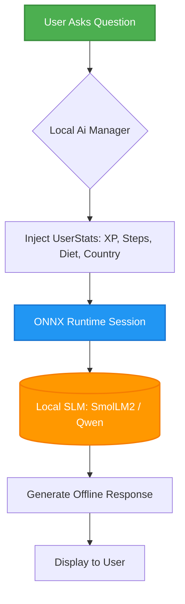
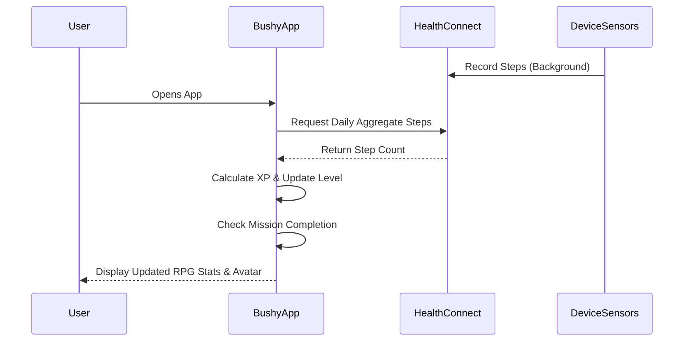

<div align="center">
  <h1>🌿 Bushy</h1>
  <p><b>Turn your real-life grind into a game. Complete fitness quests, earn XP, level up your character, and flex your progress. 🎮💪</b></p>
</div>

---

## 📖 About Bushy
**Bushy** is an innovative Android application that transforms your daily health and fitness routines into an engaging RPG-style experience. By integrating with Android's Health Connect, Bushy automatically tracks your physical activities (like steps) and converts them into Experience Points (XP). Level up your character, complete daily fitness quests, and stay motivated!

Beyond gamification, Bushy features a **Local AI Coach** running entirely on-device (via ONNX Runtime), ensuring lightning-fast advice and 100% privacy for your health questions.

## ✨ Features
* **🎮 Gamified Fitness:** Every step and logged exercise earns you XP. Watch your character level up and evolve as you get healthier.
* **🤖 Local AI Coach (Bushy AI):** Powered by ONNX Runtime, our on-device AI runs directly on your phone. Ask for workout plans, nutritional advice, and motivation—no internet connection required!
* **🔗 Health Connect Integration:** Seamlessly syncs your daily steps and health metrics securely from other fitness apps.
* **🎯 Daily Quests & Tasks:** Set custom targets for steps, pushups, and more.
* **🥗 Diet & Nutrition Logging:** Track your meals, calories, and macronutrients (protein, carbs, fats).
* **👤 Dynamic Avatars:** Your avatar's expression changes based on your current fitness streak and activity.
* **🎨 Modern UI:** Built entirely using Jetpack Compose with beautiful Material 3 design, dynamic theming, and Dark Mode support.

## 🧠 How It Works (Under the Hood)

### 1. The Core Concept: Gamified Fitness RPG
Your fitness journey is treated like a Role-Playing Game (RPG). 
* **XP & Leveling:** Earn Experience Points (XP) by walking and completing tasks. Your level scales mathematically (`Level = sqrt(XP / 100) + 1`), meaning leveling up gets progressively harder.
* **Dynamic Avatar:** Your avatar reacts to your progress. Hit your step goals and the avatar becomes celebratory; tap it and it reacts dynamically.

### 2. The Brains: Local AI (Bushy Wushy)
Bushy features a 100% on-device, offline AI assistant utilizing **ONNX Runtime**.
* **The Models:** Offers two state-of-the-art Small Language Models (SLMs) fine-tuned for mobile:
  * **SmolLM2 360M:** Lightweight (~360 MB), ultra-fast model by Hugging Face.
  * **Qwen 2.5 0.5B:** Highly capable balanced model (~512 MB) by Alibaba Cloud.
* **Contextual Awareness:** The AI automatically reads your current stats (steps, calories, country) to give highly contextual answers (e.g., suggesting local Indian cuisine based on your remaining daily calories).



### 3. Data Syncing: Health Connect
Instead of draining battery by counting steps in the background, Bushy integrates with the **Android Health Connect API**.
* Securely reads aggregate daily steps from midnight.
* Automatically updates your XP and step missions when you open the app.



## 🛠 Tech Stack
* **Language:** [Kotlin](https://kotlinlang.org/)
* **UI Framework:** [Jetpack Compose](https://developer.android.com/jetpack/compose)
* **Architecture:** MVVM (Model-View-ViewModel) with Kotlin Coroutines & StateFlow
* **Health Data:** [Android Health Connect API](https://developer.android.com/health-and-fitness/guides/health-connect)
* **On-Device Machine Learning:** [ONNX Runtime for Android](https://onnxruntime.ai/docs/tutorials/mobile/)
* **Image Loading:** [Coil](https://coil-kt.github.io/coil/)
* **Camera Features:** [CameraX](https://developer.android.com/training/camerax) (Support for 16 KB page size architecture)

## 📱 Requirements
* Android Device running **Android 8.0 (API 26)** or higher.
* To use the Health Connect features, the [Health Connect](https://play.google.com/store/apps/details?id=com.google.android.apps.healthdata) app must be installed on older devices (built-in on Android 14+).

## 🚀 How to Build and Run
1. Clone the repository:
   ```bash
   git clone https://github.com/krishdeokk/Bushy.git
   ```
2. Open the project in **Android Studio** (Koala Feature Drop or newer recommended).
3. Let Gradle sync the dependencies.
4. If you plan to test the on-device AI, be aware that models will be downloaded locally upon first use.
5. Connect your device or emulator and click **Run**.

## 🛡 Privacy First
Because health data is deeply personal, **Bushy** respects your privacy. 
* Steps and activity data are read locally via **Health Connect**.
* AI interactions are processed locally using **ONNX Runtime**—your prompts and fitness questions never leave your device.

---
<div align="center">
  <i>Developed with ❤️ by <a href="mailto:krishdeokate206@gmail.com">krishdeokk</a></i>
</div>
